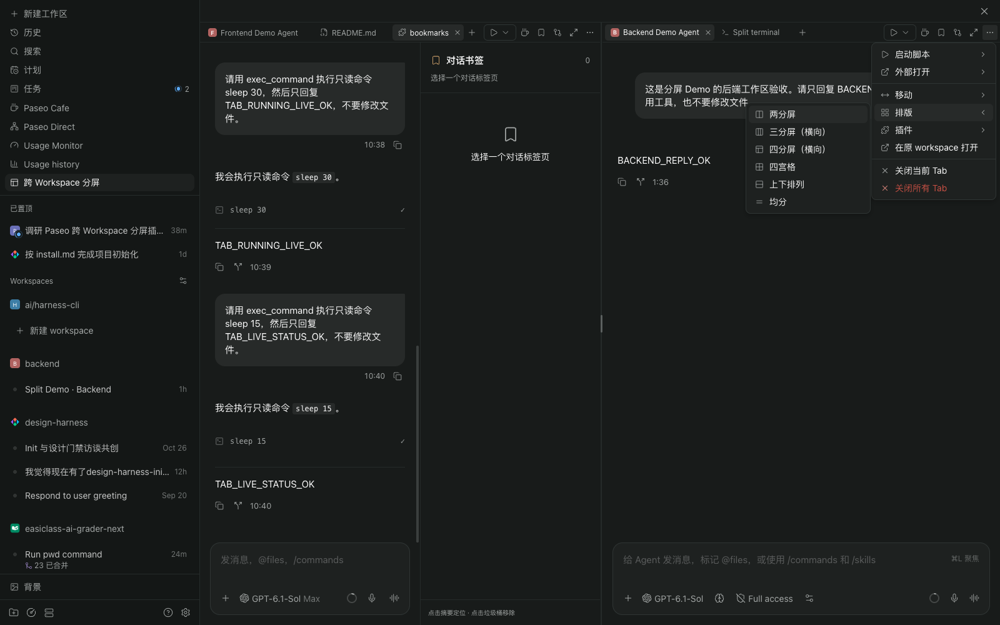
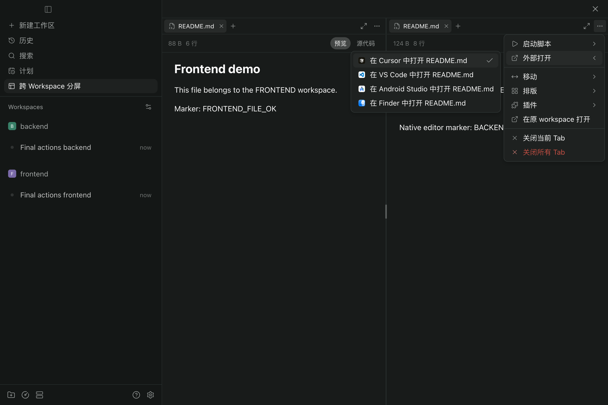

# 工作区操作与菜单验收

2026-11-12。Paseo 0.13.0、0.14.0 使用对应原始 Web 构建和独立 daemon；0.15.4 使用原始 Web 构建及真实 Electron。没有修改应用安装文件或重启主 daemon。

## 最终交互

- `＋` 统一添加资源，不再重复提供“新建分屏”菜单项。
- 更多菜单提供启动脚本、外部打开、移动、排版、插件。返回原 workspace 平铺，取消“其它”分类；底部为关闭当前 / 所有 Tab。
- 菜单行、图标和侧向展开方式统一。按实际子菜单宽度与可用空间选择左右方向，避免右侧边缘覆盖父菜单；只调整本插件菜单，卸载界面后恢复原入口。
- 插件 → 按钮显示设置控制常驻按钮，默认取当前 workspace 的前三个可用按钮。偏好按客户端与主机保存，用稳定的插件 / 按钮 ID 识别；空间不足时收纳到更多菜单。其它来源独有的按钮注明当前 workspace 未提供。
- 两分屏、横向三分屏、横向四分屏、四宫格复用现有 Tab。四宫格的横、纵分隔条均可拖动。

## 官方能力与插件

| 场景 | 结果与证据 |
| --- | --- |
| Tab 来源切换 | 同组内切换 Agent 与另一 workspace 的文件，脚本列表跟随来源；前、后端标记和 cwd 正确。[前端](artifacts/actions-script-front-capture.json)、[后端](artifacts/actions-script-back-capture.json) |
| 脚本 | 原生栏按钮与更多菜单均可启动；在当前组打开原生终端，停止后状态及时更新，重启产生新终端。[记录](artifacts/actions-experience.json) |
| 外部打开 | 原生栏及统一菜单均规划正确的 workspace / README 路径；真实 Electron 使用可用编辑器列表。为避免启动用户的编辑器，自动验收截获最终调用参数；未验证外部编辑器进程的实际启动。[参数](artifacts/actions-native-unified-editor-targets.json) |
| GitLens | 原插件组件、RPC、仓库内容与上下文可用，面板成为当前分屏 Tab，页面不跳走。[截图](artifacts/actions-gitlens-final.png) |
| 对话书签 | 侧栏与来源 Agent 并排；添加、定位高亮、删除通过，定位后仍在分屏内。[定位截图](artifacts/actions-bookmark-jump.png) |
| 保持唤醒 | 原弹层和选项可显示，验收未改变电源设置。[截图](artifacts/actions-keep-awake-popover.png) |
| 插件设置 | 勾选 / 取消即时同步各组，刷新恢复偏好，恢复默认可用。窄屏保留菜单入口。[记录](artifacts/actions-experience.json) |

官方菜单复用原脚本操作 hook、编辑器目标规划、首选项与共享查询缓存。脚本状态观察宿主 workspace store，不为每个按钮增加轮询。插件 action、menu、popover 使用原注册信息和环境；本插件只接管插件面板的打开位置。

## 排版与关闭

四种排版均验证资源唯一、位置正确；在全部预设间切换，文件编辑器的同一 DOM 实例保留。四宫格两轴均实际拖动 48px。[排版记录](artifacts/menu-layout-experience.json)

关闭全部 8 个资源后保留一个空分屏；检查原有两个 Agent 和两个终端仍在 daemon 中。未保存面板的批量关闭先做完整确认：取消第一项、先同意第一项再取消第二项，均保留全部 Tab；全部同意后才清空。该自动验收使用真实原生 modified 属性和 confirmDialog，桌面对话框后端提供确定性响应。[关闭记录](artifacts/actions-close-all-experience.json)

## 版本、样式与性能

0.13.0 / 0.14.0 均通过跨 workspace 原生文件、统一菜单 / 向左展开、四宫格、脚本终端、插件弹层、嵌套菜单与面板上下文、设置刷新恢复、关闭全部及终端保留。[0.13.0](artifacts/actions-compat-0.13.0.json)、[0.14.0](artifacts/actions-compat-0.14.0.json)

三个版本均可识别当前所需的原生入口。[契约记录](artifacts/actions-native-contracts.json) 支持范围仍为 >=0.13.0；未来构建使用私有入口，更新后需复测。

390px 下使用原生底部菜单，脚本操作行在视口内。浅色菜单、嵌套设置和左右展开均已检查。[窄屏](artifacts/actions-compact-script-menu.png)、[浅色设置](artifacts/actions-light-button-settings.png)

类型检查及 39 项模型 / 布局 / 菜单方向测试通过。最终 4 / 8 个可见资源拖动样本的面板 model 与图标 hook 构建均为 0，布局写入各 1 次，帧间隔 P95 均为 16.8ms，无 >50ms 长任务。详情见 [性能报告](PERFORMANCE.md)。

验证覆盖指定的现有插件和一个可控插件夹具，不能保证任意第三方插件的所有导航行为。普通 Web 的桌面编辑器能力由宿主决定；长期同时流式输出、语音和系统拖放等边界沿用原验收说明。
