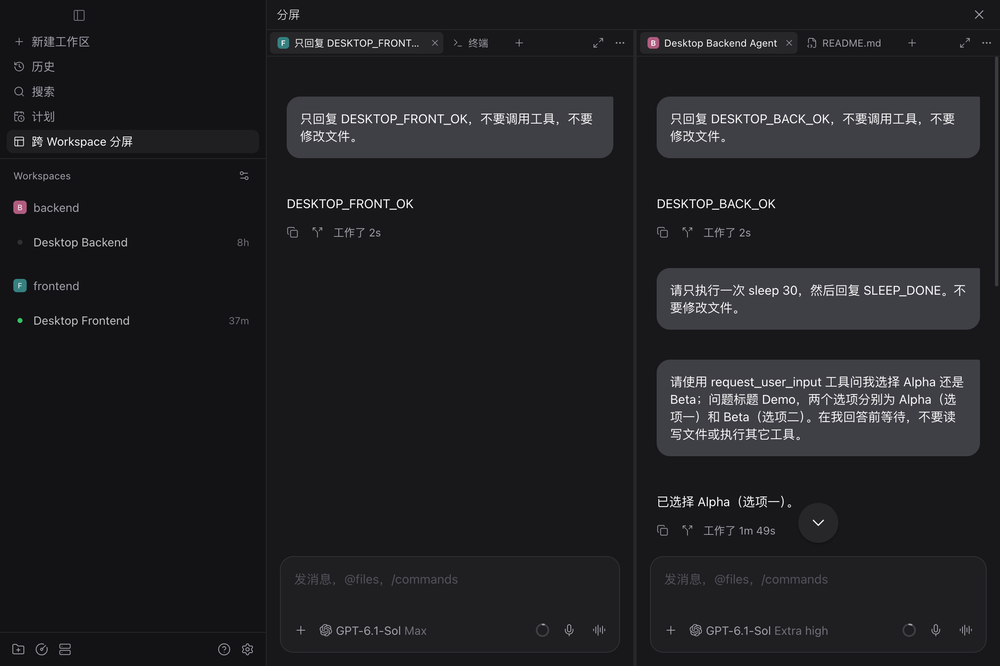

# Paseo 跨 Workspace 分屏

在一个界面中使用不同 workspace 的原生 Agent、终端和文件。每个分屏有自己的 **Tab 栏**，通过 `＋` 搜索已有 Agent、新建 Agent 或添加终端 / 文件。

本机插件已安装，入口为左侧 **跨 Workspace 分屏**，也可在 Command Center 搜索 **打开跨 Workspace 分屏**。



## 使用方式

- **添加资源**：点击目标分屏 Tab 栏中的 `＋`，或按 `Command+T`（Windows / Linux 为 `Ctrl+T`）打开当前分屏的添加面板。快捷键遵循 Paseo 的“新建 Tab”设置。统一面板支持搜索、来源 workspace 筛选、新建 Agent、终端与文件。
- **识别来源**：Agent Tab 使用来源 workspace 的原生项目图标；悬停显示完整标题与来源。运行中的 Agent 独立置顶分栏，有文字标识，Tab 也会同步显示状态。
- **选择位置**：默认加入当前分屏；在面板底部选择“新分屏”可并排打开。重复导入会切到已有 Tab。
- **整理分屏**：`···` 中可移动当前 Tab、新增分屏、切换排列、均分或返回原 workspace。窗口右侧保留放大 / 还原。
- **关闭**：关闭 Tab 只移除展示，保留 Agent 与终端；未保存文件先询问。切换、移动 Tab 会保留原生编辑器与草稿。

### 快捷键

| 操作 | macOS 桌面默认快捷键 |
| --- | --- |
| 打开当前分屏的添加面板 | `Command+T` |
| 关闭当前 Tab | `Command+W` |
| 向右切换 Tab，末尾回到第一个 | `Ctrl+Tab` |
| 向左切换 Tab，开头回到最后一个 | `Ctrl+Shift+Tab` |
| 直接选中当前分屏的第 1–8 个 Tab | `Command+Option+1` … `Command+Option+8` |
| 在当前来源 workspace 新建 Agent | `Command+Shift+A` |
| 在当前来源 workspace 新建终端 | `Command+Shift+T` |
| 添加分屏，按左右 / 上下方向排列 | `Command+\` / `Command+Shift+\` |
| 向右 / 向左切换的宿主快捷键 | `Option+Shift+]` / `Option+Shift+[` |
| 聚焦当前 Agent 输入框 | `Command+L` |

快捷键作用于当前分屏，支持消息输入框和文件编辑器内触发；切换后聚焦目标 Tab，关闭后聚焦相邻 Tab，关闭最后一个时聚焦 `＋`。添加面板或宿主弹窗打开时暂停这些快捷键，关闭未保存文件仍须确认。`Ctrl+Tab` / `Ctrl+Shift+Tab` 固定可用，其余沿用 Paseo 的快捷键设置。Windows / Linux 的新建、关闭与聚焦默认使用 `Ctrl`；Web 版关闭默认使用 `Alt+Shift+W`，避免浏览器保留快捷键冲突。

数字跳转按当前 Tab 顺序选择，序号超出当前数量时不执行。新建 Agent / 终端默认使用活动 Tab 的来源 workspace；空分屏先选择 workspace。分屏快捷键打开目标为“新分屏”的添加面板，选定资源后再应用现有布局的左右 / 上下排列，取消不会改变布局。

桌面只保留 32px Tab 栏，无整窗选中描边或独立工具栏；活动 Tab 使用中性底色。窄屏为 36px Tab 栏，添加面板自适应可用宽度，仍贴着 Tab 显示。

分隔条带灰色握柄，悬停时显示对应方向的缩放光标，拖动时高亮；抓取区域扩大至 12px，不额外占用工作空间。

## 兼容与安装

要求 **Paseo >=0.13.0**，实测 0.13.0、0.14.0、0.15.4，含 0.15.4 真实 Electron 桌面端。桌面和 Web 可用，iOS / Android 原生客户端显示不支持提示。

需要 Node.js 24，且 Paseo 已开启插件功能：

```sh
npm run setup
npm run typecheck
npm test
paseo plugin install "$PWD/plugin"
```

修改源码后使用 `npm run reload:plugin` 热重载。原有 v1 布局自动迁移，每个旧窗口成为一个单 Tab 分屏，迁移前保留本地备份。布局仍保存在当前客户端 `paseo-split-demo:board:<hostId>`，独立于 Paseo 原有布局。

公开 API 尚未提供完整原生面板嵌入组件。本插件通过当前客户端的私有 Metro 运行时复用原生组件、上下文、查询缓存、图标和快捷键，不修改应用安装文件。运行入口按实际构建动态识别；缺失能力或回退构建不匹配时提示失败。允许安装到后续版本不代表未来版本均已验收。

## 验收与性能

[Tab 版验收记录](TABS-RESULTS.md) · [交互方案](design/INTERACTION-DESIGN.md) · [性能报告](PERFORMANCE.md) · [初期可行性调研](RESEARCH.md)

保留原生会话与内容实例，未访问 Tab 延迟挂载，隐藏内容释放可见时间线登记。运行状态使用一个可释放的元数据订阅；图标查询不进入拖动渲染路径。布局按帧更新、300ms 防抖写入，退出补写。

当前支持同一所选 host 内跨 workspace，总计最多 8 个资源 Tab / 8 个分屏；选择器读取最近最多 200 个 Agent / workspace。语音、系统拖放、所有 provider / MCP 及长期高负载等未逐项覆盖，详见验收记录。

独立浏览器验收可运行 `npm run demo`，命令打印临时本地链接。服务只监听 loopback，读取已安装 Paseo 的静态资源，在服务端使用本地 credential 转发连接；credential 不传给浏览器，不修改应用文件。Ctrl+C 停止服务不影响已安装插件。

macOS 默认读取 `/Applications/Paseo.app/Contents/Resources/app-dist`；可通过 `PASEO_SPLIT_APP_DIST` 指定对应版本目录，通过 `PASEO_SPLIT_DEMO_PORT` 调整验收端口。
