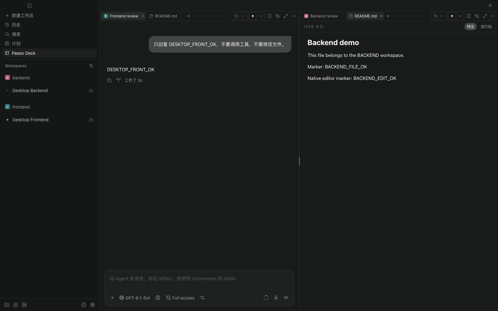
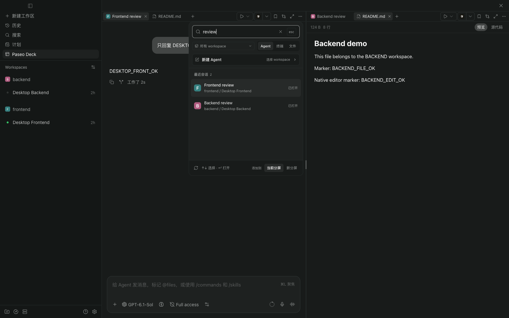
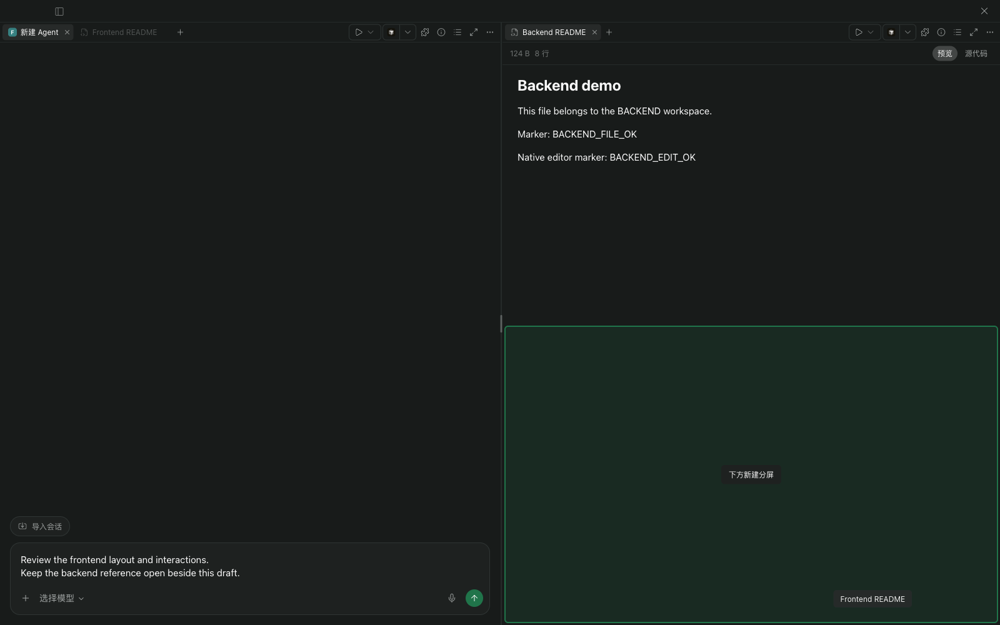
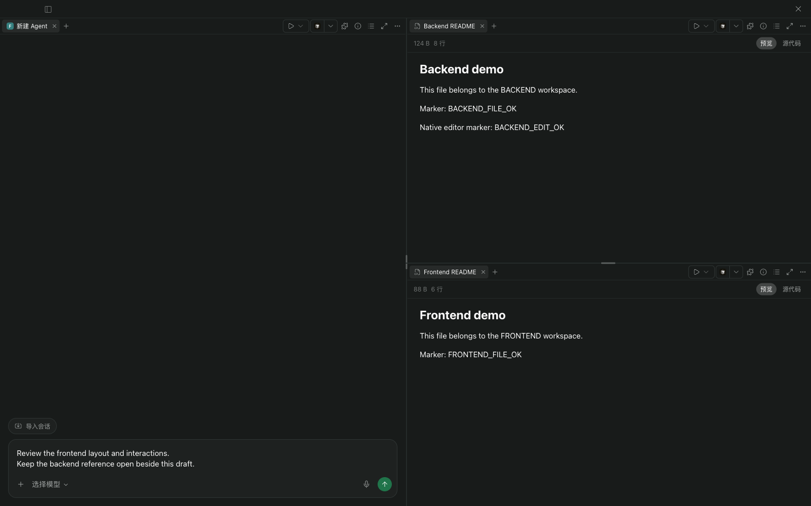
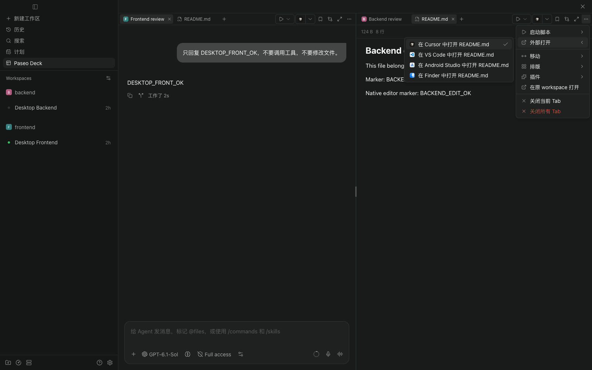
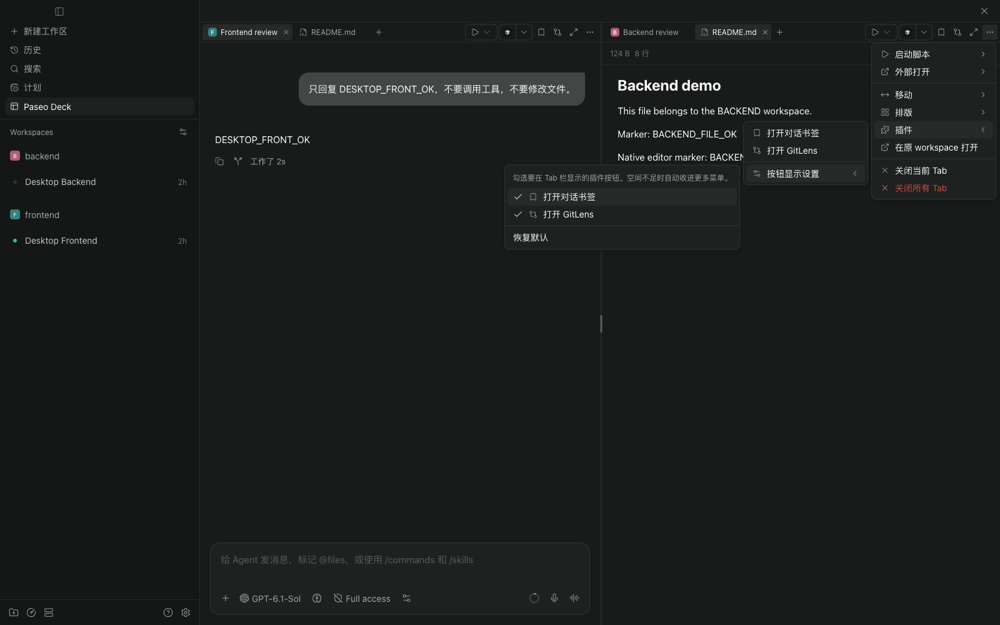

<h1 align="center">Paseo Deck</h1>

<p align="center"><strong>Agents, terminals, and files across workspaces, in one Paseo window.</strong></p>

<p align="center">
  <a href="plugin/paseo-plugin.json"></a>
  <a href="#scope-and-compatibility"></a>
</p>

<p align="center"><strong>English</strong> · <a href="README.zh-CN.md">简体中文</a></p>

<p align="center">
  <a href="#get-started">Get started</a> ·
  <a href="#add-agents-and-resources">Add resources</a> ·
  <a href="#drag-tabs">Drag Tabs</a> ·
  <a href="#arrange-your-splits">Layouts</a> ·
  <a href="#use-workspace-actions">Workspace actions</a> ·
  <a href="#develop-and-verify">Development</a> ·
  <a href="https://github.com/MinLeeV5/paseo-deck">GitHub</a> ·
  <a href="https://github.com/MinLeeV5/paseo-deck/issues">Issues</a>
</p>

- **Work across workspaces**: Bring existing Agents, terminals, and files into the same view on one host.
- **Keep native conversations**: Use Paseo's conversation UI, composer, and file panels inside each split.
- **Follow native Agent status**: Tabs show running, unread, input / approval requests, and failures, with Paseo's existing read behavior.
- **Share Agent drafts**: Unsent text stays in sync between Deck and the Agent's original workspace on the same client.
- **Drag Tabs into place**: Reorder Tabs, move them between splits, or drop at an edge to create a new split.
- **Arrange your work**: Give each split its own Tabs, resize panes, and choose common layouts.
- **Follow the current workspace**: Run its scripts, open its files in an editor, and use its plugin buttons.
- **Remember your setup**: Restore layouts and choose which plugin buttons stay in the Tab bar.



_Screenshots show the current Paseo Deck interface in isolated demo workspaces._

## Get started

Requires **Paseo daemon and client 0.13.0+**, with Git available on the daemon host. Supports the desktop app and Web client.

In **Settings → Plugins**, enable plugins on the target daemon. Paste the following into **Plugin source**, then select **Install plugin**:

```text
git:MinLeeV5/paseo-deck:plugin
```

Or install from a terminal on the daemon host:

```bash
paseo plugin install git:MinLeeV5/paseo-deck:plugin
```

The `:plugin` suffix selects the plugin directory inside the repository. Paseo downloads the source; no manual clone or dependency installation is needed.

Open **Paseo Deck** in the sidebar, or search for **Paseo Deck** in the Command Center (`⌘K` / `Ctrl+K`). Plugin ID: `paseo-deck`. Current plugin menu labels are in Simplified Chinese.

To update an installation made from this GitHub source, run:

```bash
paseo plugin update paseo-deck
```

Paseo shows the latest revision from the repository's default branch and asks for confirmation before updating.

## Add Agents and resources

Click a split's **`＋`** to open the unified add panel. Search existing Agents, filter by workspace, or create an Agent, terminal, or file view. Running and initializing Agents have a separate section; Agent Tabs use their source workspace's icon.

Agent Tabs overlay Paseo's native status on the workspace icon: a running spinner, a green unread dot, a yellow input / approval alert, or a red failure dot. Background Tabs update before their conversation is opened, and tooltips include the status. Read behavior comes from the native conversation; focusing a pending question or approval does not dismiss its alert.

The Paseo Deck sidebar entry summarizes Tabs added to the board, with an icon and count for input / approval requests, failures, running, and unread. Zero counts disappear. Counts stay current away from Deck and after restoring a layout; hover for the full status summary.

Choose the current split or a new split as the destination. Adding an Agent or terminal that is already on the board focuses its existing Tab.



## Drag Tabs

Drag a Tab by its title, watch the insertion marker or area preview, then release it at the destination:

| Drop target | Result |
| --- | --- |
| Its current Tab bar | Reorder the Tab at the insertion marker |
| Another split's Tab bar | Move the Tab to the indicated position in that split |
| The center of another split's content area | Move the Tab into that split's existing group |
| The left, right, top, or bottom edge of a content area | Create a new split in that direction and move the Tab into it |



_While dragging, the highlighted lower half previews where the new split will appear._

Dragging preserves the conversation, terminal, or file view, including unsent drafts and unsaved edits. Dropping at an edge divides the target area, so you can extend an existing layout one split at a time.

For example, start with two columns and at least two Tabs on the left. Drag one of the left Tabs to the bottom edge of the right pane: the left pane remains, and the right pane becomes two stacked panes.



_After dropping, the draft stays on the left; Backend README and Frontend README sit above and below on the right._

Press `Esc` or release outside the board to cancel. Moving a split's last Tab out removes the empty split; to increase the total split count, drag from a split that contains at least two Tabs.

## Arrange your splits

Resize splits using the divider grips, or maximize a split temporarily.

Use **`··· → 排版`** for presets:

| Layout         | Arrangement   |
| -------------- | ------------- |
| 两分屏         | Two columns   |
| 三分屏（横向） | Three columns |
| 四分屏（横向） | Four columns  |
| 四宫格         | A 2 × 2 grid  |

Presets redistribute existing Tabs and preserve their content instances, creating empty splits when needed. Vertical stacking and equal sizing are also available.

Closing Tabs removes their views and keeps the Agents and terminals. Closing a running or initializing Agent Tab asks for confirmation; the Agent continues running after its Tab closes. **关闭所有 Tab** closes the whole board after confirming running Tabs and checking unsaved content; canceling any confirmation keeps the entire batch. Tab context menus provide rename, copy, reload, and close-left/right/others actions where applicable; those batch actions stay within the clicked Tab's group. Agent Tabs also offer **归档 Agent**: after confirmation, it archives the Agent and closes all of its Tabs on the board, stopping any running task.

## Use workspace actions

The right side of a Tab bar follows the **active Tab's source workspace**, even when a group contains Tabs from several workspaces.

- **启动脚本**: Start, stop, restart, or view a workspace script. Its native terminal opens in the same split.
- **外部打开**: Open the workspace or current file using a target available through Paseo, such as an editor or file manager.
- **插件**: Use registered workspace buttons and open their panels inside the board. GitLens uses a Tab; conversation bookmarks can sit beside their source conversation.

These actions remain available in **`···`** when narrow splits hide their toolbar shortcuts. Menus share the same row style and open to the left when there is insufficient room on the right; compact layouts use native sheets.



## Choose your toolbar buttons

Open **`··· → 插件 → 按钮显示设置`** to choose which plugin buttons stay outside the menu. Defaults use the current workspace's first three available buttons. Selected buttons move into the menu when space is limited; unavailable workspace contributions are labeled.

Layouts and toolbar preferences are saved **per host on the current client**. They do not sync between clients. Agent messages, files, terminals, and scripts continue through Paseo's existing host and provider connections.



## Keyboard shortcuts

Shortcuts act on the focused split and follow Paseo's configured bindings. These are desktop defaults on macOS:

| Shortcut                      | Action                                             |
| ----------------------------- | -------------------------------------------------- |
| `⌘T` / `⌘W`                   | Add / close a Tab                                  |
| `Ctrl+Tab` / `Ctrl+Shift+Tab` | Next / previous Tab                                |
| `⌘⌥1` … `⌘⌥8`                 | Select a Tab by its position                       |
| `⌘⇧A` / `⌘⇧T`                 | New Agent / terminal in the current workspace      |
| `⌘\` / `⌘⇧\`                  | Add a split with horizontal / vertical arrangement |
| `⌘L`                          | Focus the Agent composer                           |
| `Shift+F10`                   | Open the focused Tab's context menu                |
| `Esc`                         | Dismiss a menu or cancel a drag                    |

On Windows/Linux, creation, closing, and composer focus use Paseo's `Ctrl` bindings. Web closing defaults to `Alt+Shift+W` to avoid the browser's reserved shortcut. Dialogs and the add panel suspend board shortcuts; unsaved-content checks still apply.

## Scope and compatibility

- One selected host, up to **8 splits**, with no limit on resource Tabs. The add panel reads up to 200 Agents and 200 workspaces.
- Tested with matching daemon/client builds of **0.13.0, 0.14.0, and 0.15.4**, including the 0.15.4 Electron app on macOS. Native iOS/Android clients are not supported.
- This experimental plugin reuses **private Paseo UI components** without modifying application files. Future app builds may require a compatibility update; an unsupported build displays an error.
- Third-party panels keep their own behavior and requirements. GitLens, conversation bookmarks, and Keep awake were exercised; this does not establish compatibility with every plugin.

## Develop and verify

For local development, clone the repository and install the development dependencies. Requires **Node.js 24+**:

```bash
git clone https://github.com/MinLeeV5/paseo-deck.git
cd paseo-deck
npm run setup
npm run typecheck
npm test
npm run install:plugin
```

After source changes, run the checks and `npm run reload:plugin`. Reload the plugin to apply code changes.

| Command                 | Purpose                                                           |
| ----------------------- | ----------------------------------------------------------------- |
| `npm run setup`         | Install development dependencies for the repository and plugin    |
| `npm run typecheck`     | Check TypeScript                                                  |
| `npm test`              | Run model, layout, shortcut, menu-placement, and clean-build tests |
| `npm run reload:plugin` | Reload `paseo-deck` on the selected local daemon                  |
| `npm run demo`          | Open the installed Paseo Web UI through a temporary local harness |

The clean-build test copies the plugin without `node_modules` and compiles both entries with the installed Paseo compiler. It defaults to `/Applications/Paseo.app/Contents/Resources`; override with `PASEO_DECK_APP_RESOURCES` and use `PASEO_DECK_NODE` to select the Electron executable. Keep SDK data types derived from `@getpaseo/plugin/client`, so Git installs need no development dependencies.

The demo prints an authenticated loopback URL. On macOS it reads `/Applications/Paseo.app/Contents/Resources/app-dist`; override with `PASEO_DECK_APP_DIST` and change the port with `PASEO_DECK_DEMO_PORT`. `PASEO_DECK_HOME` selects an isolated daemon. See [the harness](tools/demo.mjs) for all options.

Verification: [Tabs](TABS-RESULTS.md), [native Tab status](TAB-STATUS-RESULTS.md), [sidebar status counts](SIDEBAR-STATUS-RESULTS.md), [dragging to split](SPLIT-DRAG-RESULTS.md), [workspace actions and menus](ACTIONS-RESULTS.md), [Tab context menus](TAB-CONTEXT-RESULTS.md), and [Agent draft sync](DRAFT-SYNC-RESULTS.md). Measurements and test boundaries are in the [performance report](PERFORMANCE.md); see the [interaction design](design/INTERACTION-DESIGN.md) and [initial feasibility research](RESEARCH.md) for background.
