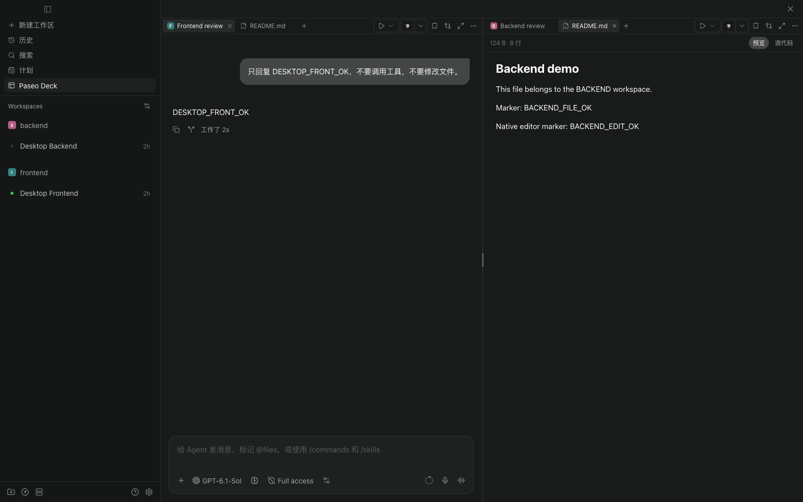
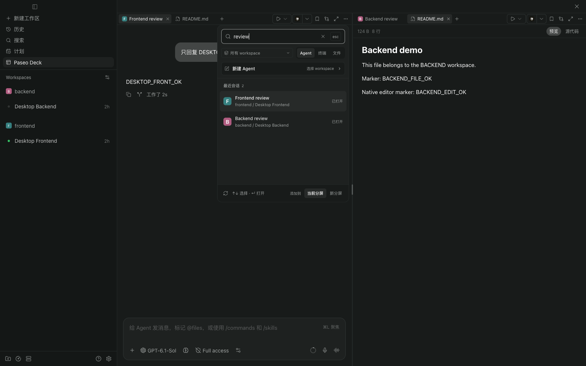
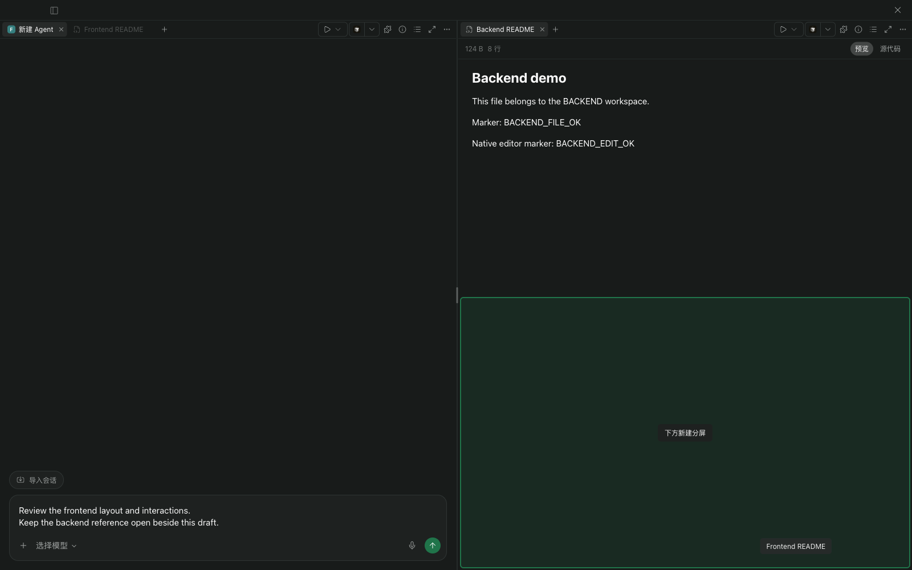
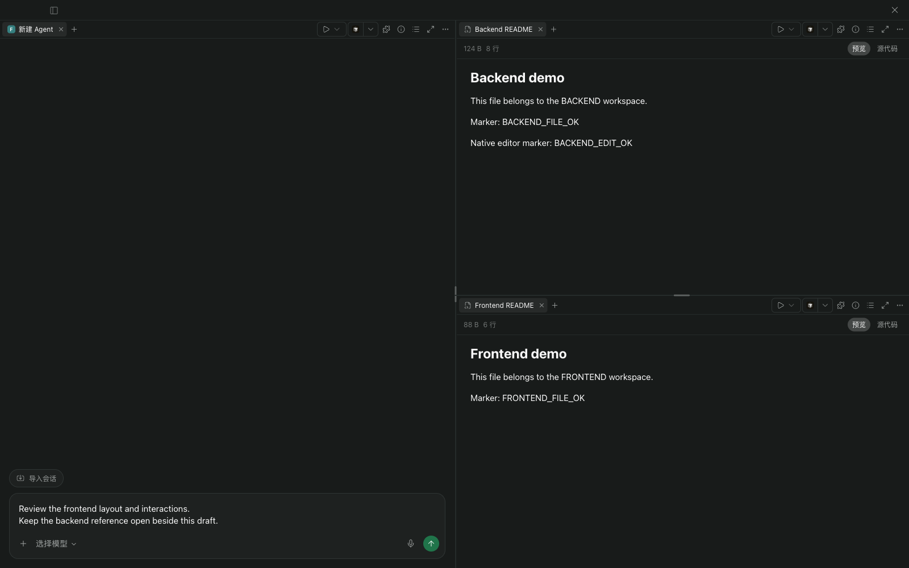
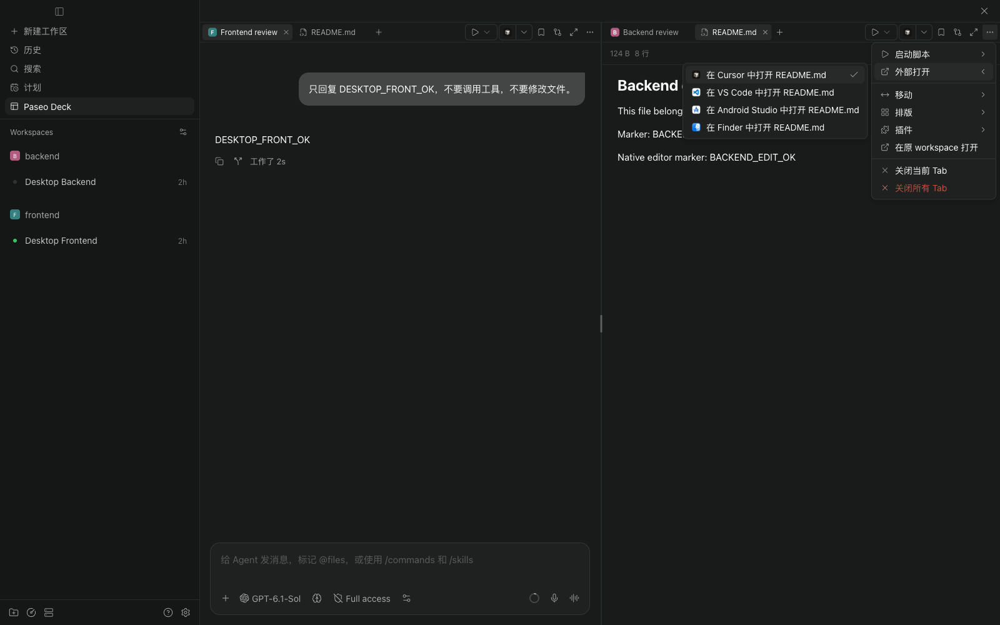
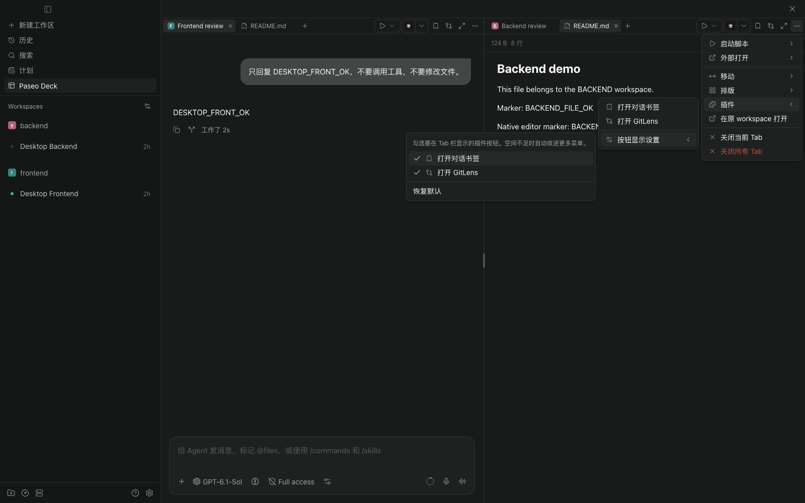

<h1 align="center">Paseo Deck</h1>

<p align="center"><strong>在一个 Paseo 窗口中，并排使用不同工作区的 Agent、终端和文件。</strong></p>

<p align="center">
  <a href="plugin/paseo-plugin.json"></a>
  <a href="#支持范围与兼容性"></a>
</p>

<p align="center"><a href="README.md">English</a> · <strong>简体中文</strong></p>

<p align="center">
  <a href="#快速开始">快速开始</a> ·
  <a href="#添加-agent-与资源">添加资源</a> ·
  <a href="#拖动-tab">拖动 Tab</a> ·
  <a href="#整理分屏">分屏排版</a> ·
  <a href="#使用工作区操作">工作区操作</a> ·
  <a href="#开发与验证">开发指南</a> ·
  <a href="https://github.com/MinLeeV5/paseo-deck">GitHub</a> ·
  <a href="https://github.com/MinLeeV5/paseo-deck/issues">问题反馈</a>
</p>

- **跨工作区使用**：将同一主机上不同工作区的已有 Agent、终端和文件放在一起。
- **原生对话体验**：在分屏中使用 Paseo 的原生会话、输入框与文件面板。
- **原生会话状态**：Tab 同步显示运行、未读、等待输入 / 审批和失败提示，沿用 Paseo 的已读规则。
- **共享 Agent 草稿**：同一客户端内，Deck 与 Agent 原工作区的未发送文字双向同步。
- **拖动 Tab**：调整标签顺序、跨分屏移动，或拖到边缘创建新分屏。
- **灵活整理布局**：每个分屏拥有独立 Tab，可自由缩放或选择常用排版。
- **跟随当前来源**：运行当前 Tab 所属工作区的脚本，打开编辑器，使用插件按钮。
- **记住使用习惯**：恢复布局，自选常驻 Tab 栏的插件按钮。



_截图使用独立示例工作区，展示当前 Paseo Deck 界面。_

## 快速开始

要求 **Paseo daemon 和客户端均为 0.13.0+**，且 daemon 所在主机已安装 Git。支持桌面应用与 Web 客户端。

在目标 daemon 的 **Settings → Plugins** 中启用插件，将以下来源粘贴到 **Plugin source**，点击 **Install plugin**：

```text
git:MinLeeV5/paseo-deck:plugin
```

也可以在 daemon 所在主机的终端执行：

```bash
paseo plugin install git:MinLeeV5/paseo-deck:plugin
```

末尾的 `:plugin` 指定仓库中的插件目录。Paseo 会自行下载源码，无需手动克隆仓库或安装依赖。

点击侧栏 **Paseo Deck**，或在 Command Center（`⌘K` / `Ctrl+K`）中搜索 **Paseo Deck**。插件 ID 为 `paseo-deck`，当前插件菜单使用简体中文。

通过上述 GitHub 来源安装后，可执行以下命令更新：

```bash
paseo plugin update paseo-deck
```

Paseo 会显示仓库默认分支的最新版本，确认后才会更新。

## 添加 Agent 与资源

点击分屏 Tab 栏中的 **`＋`**，打开统一添加面板。可以搜索已有 Agent、筛选来源工作区，也可以新建 Agent、终端或文件视图。运行中与启动中的 Agent 单独分栏，Agent Tab 使用来源工作区的图标。

Agent Tab 在工作区图标上叠加 Paseo 原生状态：运行时转圈、新回复显示绿色未读点、等待回答或审批显示黄色提示、失败显示红点。状态实时更新，即使尚未打开该 Tab；悬停提示也包含状态说明。已读处理沿用原生会话行为，等待回答或审批不会因切换或聚焦而消失。

选择加入当前分屏或新分屏。重复添加已在工作台中的 Agent 或终端时，会切换到已有 Tab。



## 拖动 Tab

按住 Tab 标题开始拖动，观察插入线或区域预览，在目标位置松手：

| 放置位置 | 效果 |
| --- | --- |
| 当前 Tab 栏 | 按插入线的位置调整标签顺序 |
| 另一分屏的 Tab 栏 | 将 Tab 移到该分屏的指定位置 |
| 另一分屏内容区的中央 | 将 Tab 加入该分屏现有的标签组 |
| 内容区的左、右、上、下边缘 | 在对应方向创建新分屏，并将 Tab 移入其中 |



_拖动过程中，下半区域高亮预览新分屏的位置。_

拖动会保留原来的会话、终端或文件视图，未发送草稿和未保存编辑也会保留。拖到边缘会拆分目标区域，可以在现有布局中逐步增加分屏。

例如，当前为左右两列，且左侧至少有两个 Tab：将左侧的一个 Tab 拖到右侧内容区的下边缘，左侧分屏保留，右侧变为上下两个分屏，即可从两屏变为三屏。



_松手后，左侧草稿保留，右侧上方是 Backend README，下方是 Frontend README。_

按 `Esc` 或拖到工作台外松手可取消。移走分屏的最后一个 Tab 后，空分屏会自动收拢；要增加分屏总数，请从至少有两个 Tab 的分屏中拖出一个。

## 整理分屏

握住分隔条可调整大小，也可临时放大一个分屏。

在 **`··· → 排版`** 中选择预设：

| 排版           | 布局       |
| -------------- | ---------- |
| 两分屏         | 两列       |
| 三分屏（横向） | 三列       |
| 四分屏（横向） | 四列       |
| 四宫格         | 2 × 2 网格 |

自动排版会重新分配已有 Tab，保留内容实例，需要时创建空分屏。菜单还提供上下排列与均分。

关闭 Tab 只移除展示，保留 Agent 和终端。**关闭所有 Tab** 作用于整个工作台，先检查未保存内容；取消任意确认会保留整批 Tab。Tab 右键菜单按资源类型提供重命名、复制、重新加载、关闭左侧 / 右侧 / 其它标签等操作，其中批量关闭只作用于被右键 Tab 所在组。

## 使用工作区操作

Tab 栏右侧操作跟随**活动 Tab 的来源工作区**，同一组中混排不同工作区时也一样。

- **启动脚本**：启动、停止、重启或查看工作区脚本，原生终端在同一分屏打开。
- **外部打开**：通过 Paseo 提供的编辑器或文件管理器，打开工作区或当前文件。
- **插件**：使用工作区已注册的按钮，在分屏内打开对应面板。GitLens 使用 Tab，对话书签可与来源会话并排。

窄分屏收起栏上的快捷按钮后，仍可从 **`···`** 访问这些操作。菜单行样式一致，右侧空间不足时向左展开；窄屏使用原生底部面板。



## 选择常驻按钮

打开 **`··· → 插件 → 按钮显示设置`**，选择要显示在 Tab 栏中的插件按钮。默认显示当前工作区的前三个可用按钮；空间不足时自动收进菜单，当前工作区未提供的按钮会注明。

布局与按钮偏好按主机保存在**当前客户端**，不会在不同客户端间同步。Agent 消息、文件、终端和脚本继续使用 Paseo 现有的主机连接及模型提供商配置。



## 快捷键

快捷键作用于当前分屏，并沿用 Paseo 的绑定设置。以下为 macOS 桌面端默认值：

| 快捷键                        | 操作                            |
| ----------------------------- | ------------------------------- |
| `⌘T` / `⌘W`                   | 添加 / 关闭 Tab                 |
| `Ctrl+Tab` / `Ctrl+Shift+Tab` | 下一个 / 上一个 Tab             |
| `⌘⌥1` … `⌘⌥8`                 | 按位置选择 Tab                  |
| `⌘⇧A` / `⌘⇧T`                 | 在当前工作区新建 Agent / 终端   |
| `⌘\` / `⌘⇧\`                  | 添加分屏，按左右 / 上下方向排列 |
| `⌘L`                          | 聚焦 Agent 输入框               |
| `Shift+F10`                   | 打开已聚焦 Tab 的右键菜单       |
| `Esc`                         | 关闭菜单或取消拖动              |

Windows / Linux 的创建、关闭和聚焦沿用 Paseo 的 `Ctrl` 绑定。Web 版关闭默认使用 `Alt+Shift+W`，避开浏览器保留快捷键。添加面板与弹窗打开时暂停工作台快捷键，未保存确认仍然生效。

## 支持范围与兼容性

- 同一所选主机内跨工作区，总计最多 **8 个资源 Tab / 8 个分屏**。添加面板读取最多 200 个 Agent 和 200 个工作区。
- 已实测配套的 **0.13.0、0.14.0、0.15.4** daemon 与客户端，含 macOS 上的 0.15.4 Electron 应用；不支持 iOS / Android 原生客户端。
- 目前为实验版本，通过 **Paseo 私有 UI 组件**复用原生体验，不修改应用安装文件。应用更新后可能需要适配；无法识别的构建会显示错误。
- 第三方插件保留各自的行为与要求。已验证 GitLens、对话书签和保持唤醒，不能据此保证所有插件的全部功能均兼容。

## 开发与验证

本地开发需要克隆仓库并安装开发依赖，要求 **Node.js 24+**：

```bash
git clone https://github.com/MinLeeV5/paseo-deck.git
cd paseo-deck
npm run setup
npm run typecheck
npm test
npm run install:plugin
```

修改源码后执行检查，再运行 `npm run reload:plugin` 热重载。

| 命令                    | 用途                                         |
| ----------------------- | -------------------------------------------- |
| `npm run setup`         | 安装仓库与插件的开发依赖                     |
| `npm run typecheck`     | 检查 TypeScript                              |
| `npm test`              | 运行资源模型、布局、快捷键、菜单定位与干净构建测试 |
| `npm run reload:plugin` | 在所选本地 daemon 热重载 `paseo-deck`        |
| `npm run demo`          | 通过临时本地服务打开已安装 Paseo 的 Web 界面 |

干净构建测试将插件复制到不含 `node_modules` 的目录，再用已安装的 Paseo 编译器构建两个入口。默认使用 `/Applications/Paseo.app/Contents/Resources`，可用 `PASEO_DECK_APP_RESOURCES` 指定资源目录、`PASEO_DECK_NODE` 指定 Electron 可执行文件。SDK 数据类型应从 `@getpaseo/plugin/client` 推导，让 Git 安装无需开发依赖。

预览命令会打印带临时认证的 loopback 链接。macOS 默认读取 `/Applications/Paseo.app/Contents/Resources/app-dist`；可用 `PASEO_DECK_APP_DIST` 指定构建目录、`PASEO_DECK_DEMO_PORT` 更改端口，或用 `PASEO_DECK_HOME` 选择隔离 daemon。完整选项见[预览脚本](tools/demo.mjs)。

验收记录：[Tab](TABS-RESULTS.md)、[Tab 原生状态](TAB-STATUS-RESULTS.md)、[拖动创建分屏](SPLIT-DRAG-RESULTS.md)、[工作区操作与菜单](ACTIONS-RESULTS.md)、[Tab 右键菜单](TAB-CONTEXT-RESULTS.md)、[Agent 草稿同步](DRAFT-SYNC-RESULTS.md)。实测数据与边界见[性能报告](PERFORMANCE.md)，设计背景见[交互方案](design/INTERACTION-DESIGN.md)与[初期可行性调研](RESEARCH.md)。
