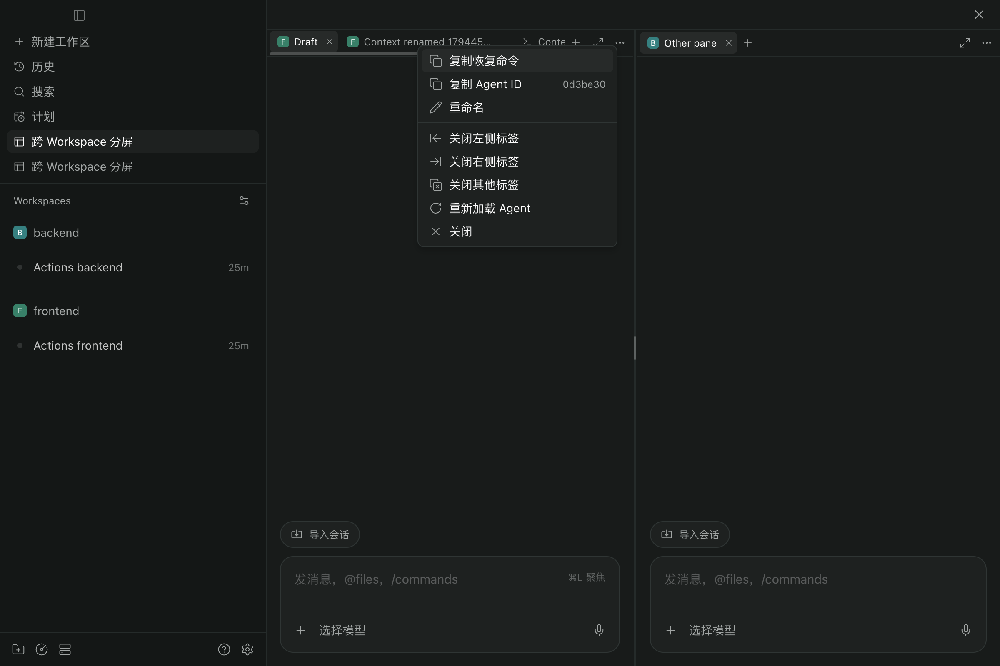
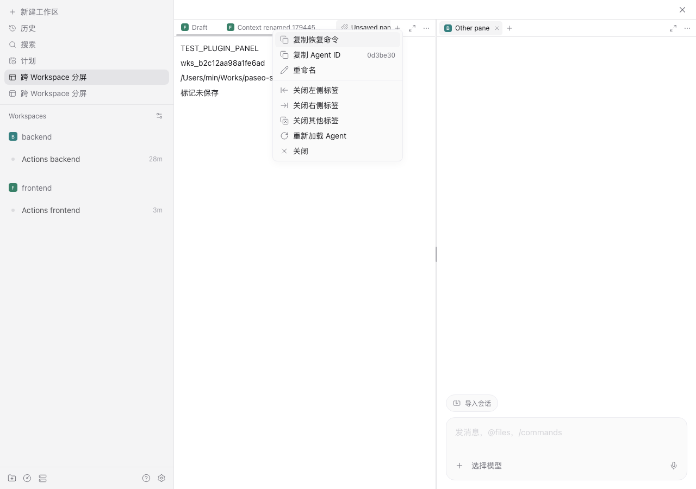
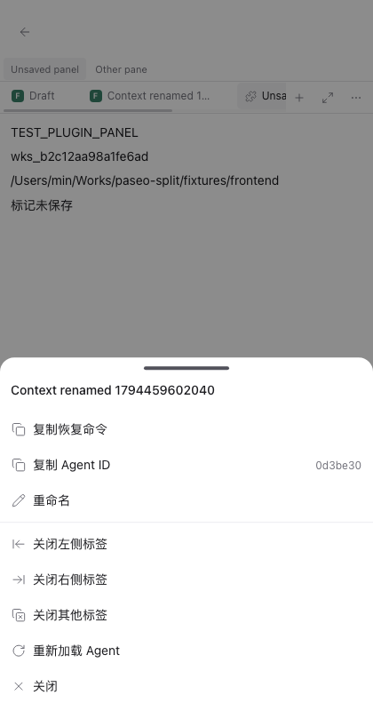

# Tab 右键菜单验收

2026-11-12，Paseo 0.15.4，隔离 Electron 与 Chromium 环境。

## 实现

复用宿主的 `ContextMenuTrigger`、`buildWorkspaceTabMenuEntries`、菜单项、文件“打开方式”和重命名弹窗。Agent 菜单与原生顺序一致：复制恢复命令、复制 Agent ID、重命名、关闭左侧、关闭右侧、关闭其他、重新加载、关闭。终端和文件根据原生规则显示对应操作，草稿仅显示关闭操作。

右键未选中的 Tab 不会切换当前内容。批量关闭依据被右键 Tab 的当前视觉顺序，限定在该分屏；先完成全部未保存确认，取消不会部分关闭。首尾与单 Tab 的无效操作由原生菜单禁用。关闭后保留 Agent 和终端资源。

终端使用宿主的自定义标题，重命名后立即更新，刷新后也保留。恢复命令在点击时读取当前 Agent 元数据，避免重载后的会话 ID 过期。

## 验证结果

- `npm run typecheck`、`git diff --check` 通过。
- 39 项单元测试通过，包括不同分屏、重排后的批量关闭范围、首尾和失效 Tab。
- 使用 0.13.0、0.14.0、0.15.4 构建分别完成原生入口契约检查与单元测试；本次实际界面操作在 0.15.4 完成。
- Electron：菜单 8 项与原生一致；Agent / 终端 ID、文件路径写入剪贴板正确；原生重命名及服务端持久化通过；非活动 Tab 右键、Shift+F10、方向键、Esc、关闭左右及其他 Tab、单 Tab 禁用、关闭最后 Tab 后聚焦添加入口通过。
- Web：原生未保存确认的取消与确认分支通过，内容和其他分屏保留；浅色桌面、深色桌面及 420px 窄屏菜单通过，窄屏使用原生底部面板并支持 Esc。

重新加载已验证调用宿主对应接口并呈现服务端结果。隔离环境的空白 Codex 会话返回 `thread/items/list is not supported yet`；菜单正确显示该原生错误，未关闭或损坏 Tab。本次没有将该结果记为成功重载。无可恢复会话 ID 时，复制恢复命令显示原生提示。

[桌面验收明细](artifacts/tab-context-experience.json) · [Web 验收明细](artifacts/tab-context-web-experience.json)

