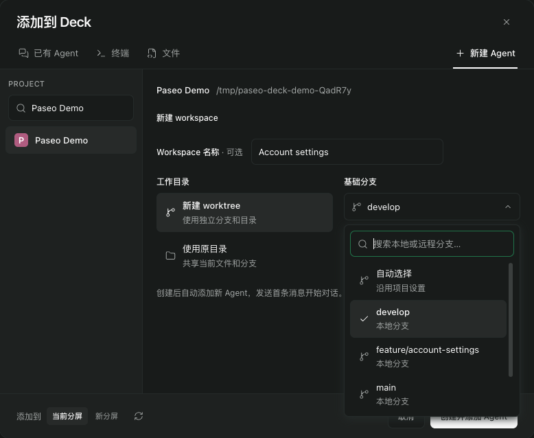

# Workspace creation and base branches

New worktrees can start from a selected local or remote branch. The original ref is passed to workspace creation, preserving the distinction between local branches and remote-tracking branches. Selecting the original directory does not send a worktree base branch.

The current client remembers the last selection separately for each host and project, including Automatic. The branch picker supports search, loading and error states, retry, keyboard selection, and Escape without dismissing the creation dialog. It opens below when there is enough room; otherwise it uses the larger available side and limits its height to that space.

The creation form places the name and input on one row, the project title and path on one row, and directory choices beside the branch picker on desktop. Narrow layouts stack the directory and branch fields. The project summary stays left-aligned and vertically centered.

## Validation

- `npm run typecheck` passed.
- `npm test` passed all 136 tests, including clean plugin compilation without development dependencies, exact local/remote base refs, directory creation, and popup placement boundaries.
- `npm pack --dry-run --ignore-scripts` from `plugin/` includes the new client module, shared placement module, both overviews, and the screenshot.
- In the packaged Paseo 0.16.1 Web UI, temporary worktrees created from local and remote selections had the selected commit as HEAD, different from the repository's default main commit.
- Verified selection after closing the dialog, switching projects, reselecting the same project, and reloading. Automatic selection also persists.
- Verified search, no matches, branch-load failure and retry, Tab/Enter selection, and Escape focus restoration.
- Checked desktop, 375px width, a low-height window, and light/dark themes. At 1280×720, the desktop form fits without scrolling. Popup geometry stays inside the dialog and clear of its trigger.
- No model messages were sent during verification.

The release screenshot uses a temporary demo project rather than personal workspace data:

