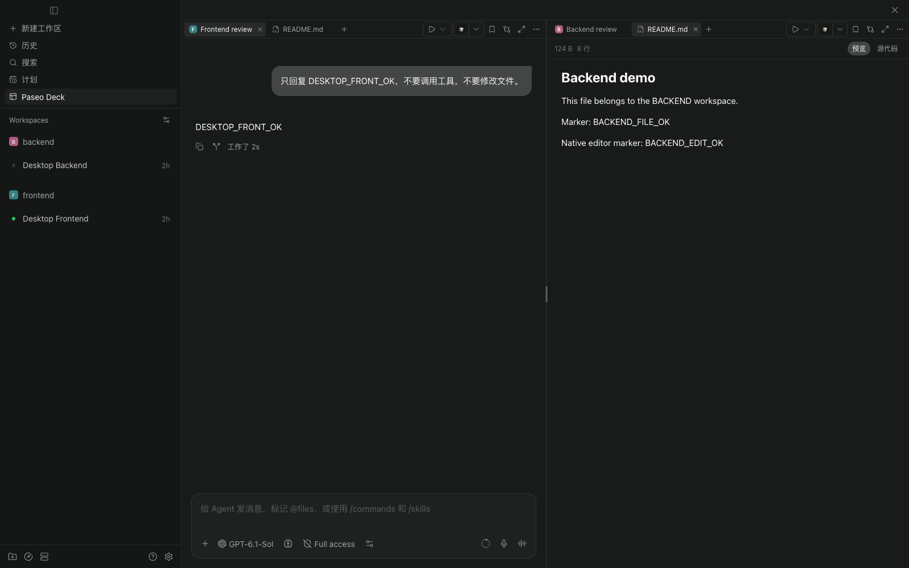
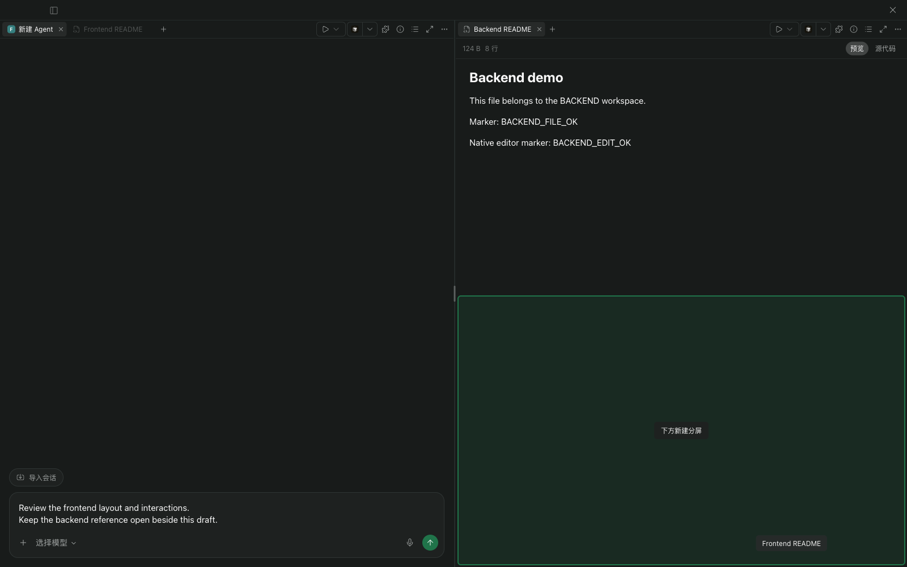
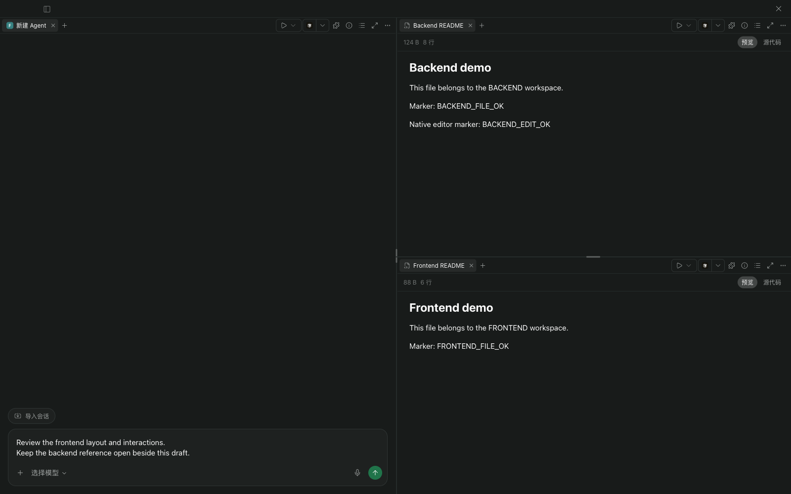
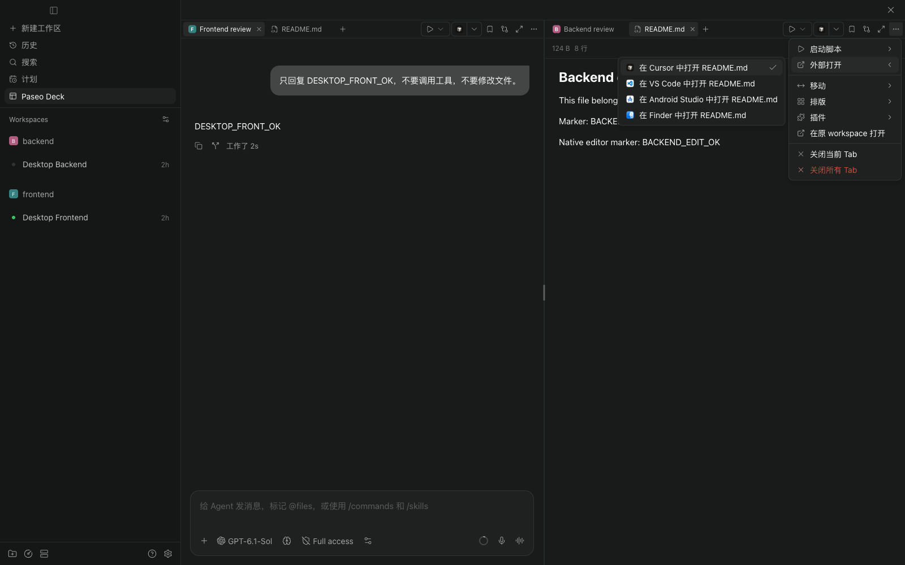

# Paseo Deck

[English](OVERVIEW.md) · [简体中文](OVERVIEW.zh-CN.md)

**Agents, terminals, and files across workspaces, in one Paseo window.**

## 🧩 Native tools across workspaces

Open Paseo Deck from the sidebar or Command Center, select a host, and use a split's `＋` to add resources. Search existing Agents, create a new Agent, or add a terminal or file view. Running Agents are grouped in the picker, and Agent Tabs show their source workspace's icon.

- **Native conversations**: Use Paseo's conversation UI, composer, and file panels inside each split.
- **Shared drafts**: Unsent text stays in sync between Deck and the Agent's original workspace on the same client.
- **Agent status at a glance**: Tabs show running, unread, input or approval requests, and failures using Paseo's native indicators and read behavior.

Closing a Tab removes its view without terminating its Agent or terminal. Unsaved content is checked before a batch closes.

## ↔️ Drag Tabs to arrange your view

Reorder Tabs within a bar, move them between splits, or drop into another split's center to join its group. Drop at a content area's left, right, top, or bottom edge to create a new split in that direction.

_The highlighted area shows where the Tab will land._

_Two columns become three panes while the draft stays in place._

Moving Tabs preserves their content, including unsent drafts and unsaved file edits. Press `Esc` or release outside the board to cancel. An empty source split collapses when its last Tab moves out.

Resize with the dividers, maximize a split temporarily, or choose two, three, or four columns or a 2 × 2 grid from the layout menu.

## ⚡ Actions from the active workspace

Each Tab bar follows its active Tab's source workspace. Run its scripts, open files in an external editor, and use registered plugin buttons and panels without leaving the board.

Choose which plugin buttons stay in the Tab bar; narrow splits keep the same actions in the overflow menu. Layouts and toolbar preferences are saved per host on the current client.

## Requirements and data

Requires **Paseo daemon and client 0.13.0+**. Desktop and Web are supported; native iOS/Android clients are not. Current plugin menus use Simplified Chinese.

A board contains up to **8 splits** from one selected host, with no limit on resource Tabs. The add panel reads up to 200 Agents and 200 workspaces. External editor targets depend on Paseo's desktop capabilities; third-party panels keep their own requirements.

Layouts and preferences do not sync between clients. Messages, attachments, and tool results use Paseo's existing host and configured provider connections. Scripts run in their source workspace on the selected host. No separate account or API key is needed for Deck.

This experimental plugin uses private Paseo UI components. Its daemon-side component reads the installed Paseo web bundle to locate native views, and its client component wraps the host composer to synchronize drafts. It does not change application files. Matching daemon/client builds of 0.13.0, 0.14.0, and 0.15.4 were tested. Future builds may need adaptation, and an unsupported build displays an error. GitLens, conversation bookmarks, and Keep awake were exercised; other integrations may behave differently.

Source, installation, and development: [MinLeeV5/paseo-deck](https://github.com/MinLeeV5/paseo-deck#readme). Report problems in [GitHub Issues](https://github.com/MinLeeV5/paseo-deck/issues).
