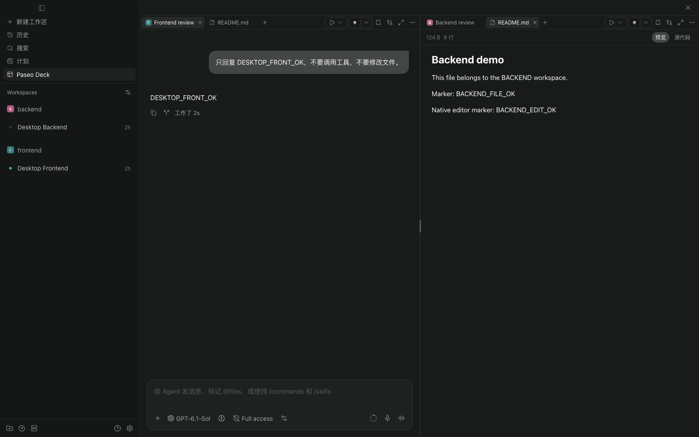
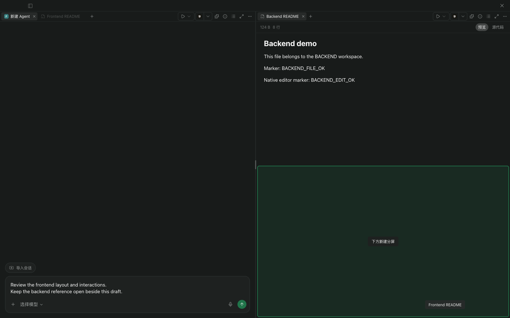
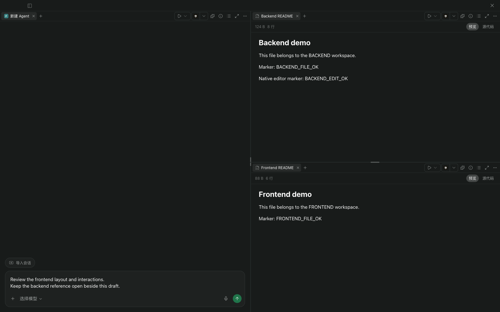
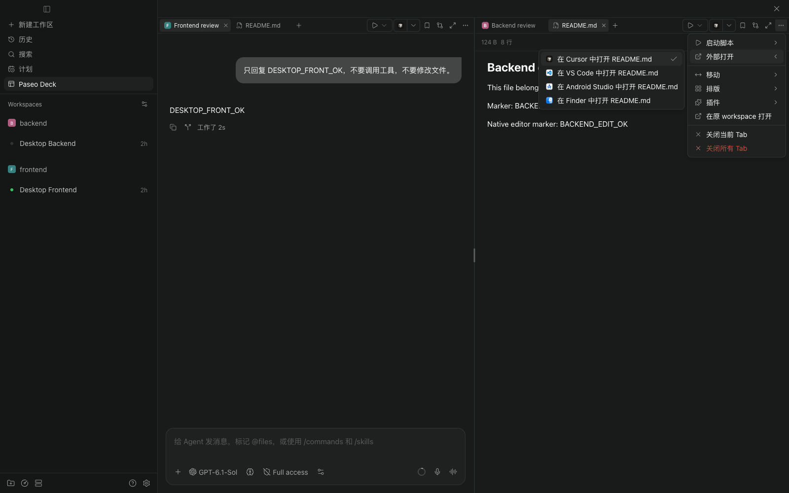

# Paseo Deck

[English](OVERVIEW.md) · [简体中文](OVERVIEW.zh-CN.md)

**在一个 Paseo 窗口中，并排使用不同工作区的 Agent、终端和文件。**

## 🧩 跨工作区，使用原生工具

从侧栏或 Command Center 打开 Paseo Deck，选择主机，点击分屏中的 `＋` 添加资源。可以搜索已有 Agent、新建 Agent，或添加终端与文件视图。添加面板会单独列出运行中的 Agent，Agent Tab 使用来源工作区的图标。

- **原生对话**：在各分屏中使用 Paseo 的原生会话、输入框与文件面板。
- **共享草稿**：同一客户端内，Deck 与 Agent 原工作区的未发送文字双向同步。
- **一眼查看状态**：Tab 使用 Paseo 原生标识显示运行、未读、等待回答或审批、失败状态，沿用原生已读规则。

关闭 Tab 只移除视图，不终止 Agent 或终端；批量关闭前会检查未保存内容。

## ↔️ 拖动 Tab，自由分屏

在同一 Tab 栏内拖动可调整顺序，拖到另一分屏的 Tab 栏或内容区中央可加入该组。拖到内容区的左、右、上、下边缘，即可在对应方向创建新分屏。

_高亮区域会预览 Tab 的落点。_

_两列变为三分屏，左侧草稿仍保留在原位。_

移动 Tab 会保留内容，包括未发送草稿与未保存的文件编辑。按 `Esc` 或拖到工作台外松手可取消；移走源分屏的最后一个 Tab 后，空分屏会自动收拢。

拖动分隔条可调整大小，也可临时放大一个分屏，或从排版菜单选择两列、三列、四列及四宫格。

## ⚡ 跟随当前工作区的操作

每条 Tab 栏的操作跟随活动 Tab 的来源工作区。在工作台内即可运行脚本、用外部编辑器打开文件，并使用已注册的插件按钮与面板。

可以自选常驻 Tab 栏的插件按钮；窄分屏仍能从更多菜单访问相同操作。布局与按钮偏好按主机保存在当前客户端。

## 要求与数据

要求 **Paseo daemon 和客户端均为 0.13.0+**。支持桌面与 Web，不支持 iOS / Android 原生客户端。当前插件菜单使用简体中文。

同一工作台支持一个所选主机中的最多 **8 个资源 Tab / 8 个分屏**。添加面板读取最多 200 个 Agent 和 200 个工作区。外部编辑器目标取决于 Paseo 桌面能力，第三方插件面板保留各自的要求。

布局与偏好不会在不同客户端间同步。消息、附件和工具结果使用 Paseo 现有的主机连接及模型提供商配置；脚本在所选主机的来源工作区执行。Deck 无需额外账号或 API 密钥。

目前为实验版本，使用 Paseo 私有 UI 组件。daemon 端组件读取已安装的 Paseo Web 构建来定位原生视图，客户端组件包装宿主输入框以同步草稿，不修改应用安装文件。已实测配套的 0.13.0、0.14.0、0.15.4 daemon 与客户端；后续构建可能需要适配，无法识别时会显示错误。已验证 GitLens、对话书签和保持唤醒，其它集成的行为可能有所不同。

源码、安装与开发指南：[MinLeeV5/paseo-deck](https://github.com/MinLeeV5/paseo-deck/blob/main/README.zh-CN.md)。问题反馈请使用 [GitHub Issues](https://github.com/MinLeeV5/paseo-deck/issues)。
